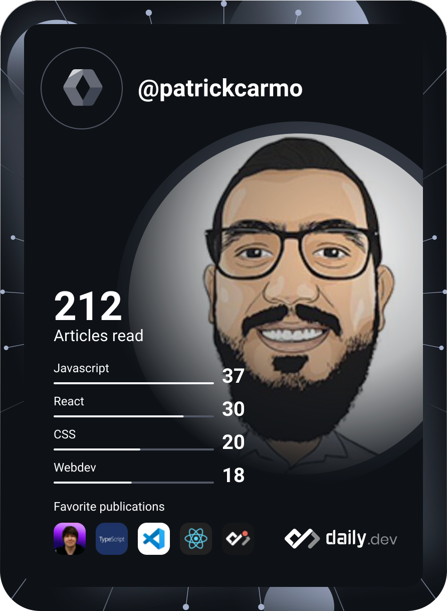

### Hi there 😃

<!--
**patrickcarmo/patrickcarmo** is a ✨ _special_ ✨ repository because its `README.md` (this file) appears on your GitHub profile.

Here are some ideas to get you started:

- 🔭 I’m currently working on ...
- 🌱 I’m currently learning ...
- 👯 I’m looking to collaborate on ...
- 🤔 I’m looking for help with ...
- 💬 Ask me about ...
- 📫 How to reach me: ...
- 😄 Pronouns: ...
- ⚡ Fun fact: ...
-->

- 👋 Hi, I’m @patrickcarmo
- 🤓 I’m Frontend Engineer, passionate about technology, learning and sharing information
- 📫 How to reach me: [Linkedin](https://www.linkedin.com/in/patrickcarmo/?locale=en_US)
- 🌱 I’m currently learning about AI, Data Science, Machine Learning and ChatBot 🤖💬

### Languages and Tools

  
  
  
  
  
  
  
  
  
  
  
  
  
  
  
  

  

